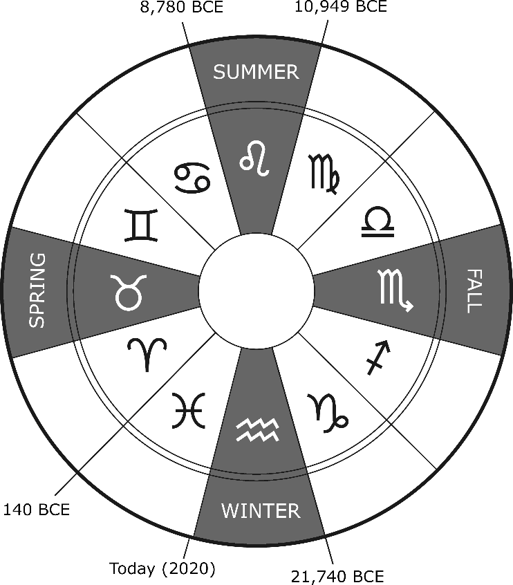

THE GREAT YEAR

In the macrocosm of the world and the universe at large, our fates are often tied to The Great Year. As above, so below.

{width=60%}

To understand The Great Year we must define terms and explore how our Earth travels in three-dimensional space. An axis is an imaginary line on which a round body like Earth rotates. Next, an equator is a line drawn through the middle of a round body so that there are two halves of equal distance. These halves are hemispheres.

The ecliptic is the plane of Earth’s orbit, the path the Sun appears to trace across our sky over a year. The Earth rotates around the Sun. The Sun rotates as it travels through space, not just around the galaxy.

There are 12 zodiacs in astrology and astronomy whose apparent likeness can be seen from Earth. These apparent connect-the-dot drawings of the night sky have been with human consciousness since before written history. The oldest confirmed astronomical zodiac represented on a stone relief is over 12,600 years ago.

Continuing, on the spring equinox a prominent astrological constellation stands behind the Sun as it rises in the East. The earth wobbles on its axis every 26,000 years so that the North Star changes. As this happens, the spring equinox slowly shifts along our ecliptic. When this happens, the prominent constellation changes from one to another. Over a period of 2,160 years the constellation behind the Sun at the spring equinox changes from one to another.

This traversal of all the constellations is known as The Great Year. The graphic above shows this. Right now, we are in the age of Pisces and are soon to enter the age of Aquarius. But why does this matter? Because everything moves, everything has rhythm, every cause has an effect, and what happens above also happens below.

The traversal of our travel through the galaxy is tied to the rhythm of life in a similar pattern to the seasons we experience on Earth. You can apply this rhythm to most things and in conjunction, with archeology and history, we can see patterns emerge.

The Cycles, as discussed before, includes cosmic cycles. It is believed that these celestial seasons in the Great Year correspond cyclically to events in the geological past, marked by a clustering of volcanic and comet/asteroid activity that shaped the course of any organism living on the planet. Symbolically, the age of Leo begins with fire, and the age of Aquarius begins with water.
