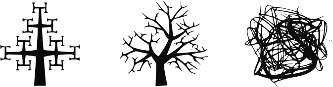
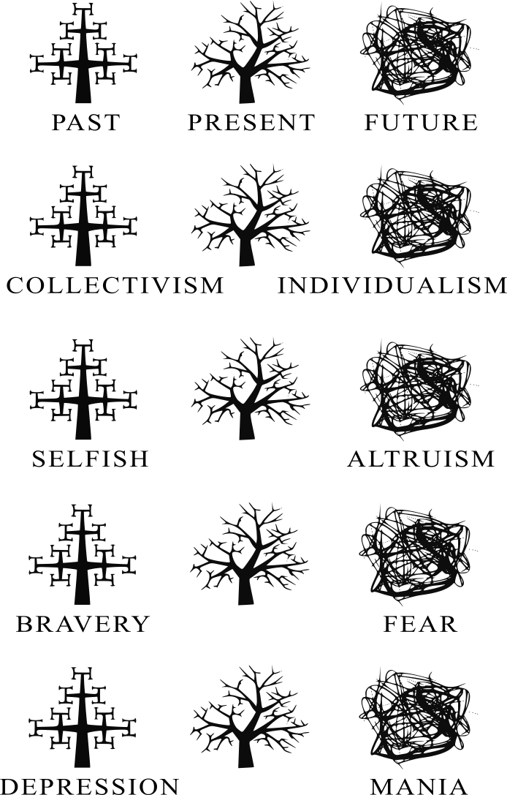
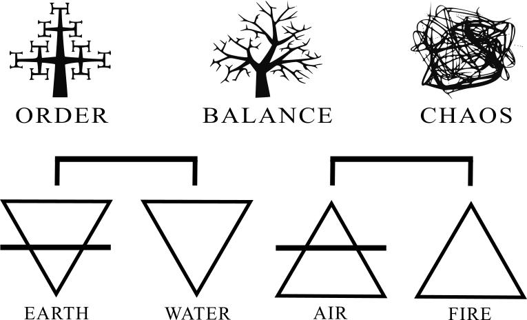

ALCHEMY

The world can be best understood and applied by using alchemical reasoning to all things. Alchemy was once the precursor to chemistry that gave rise to our modern world but has since taken on new meanings and in so doing, new ways of understanding the world.

{width=80%}

The graphic above illustrates the relationship of rigid order and pure chaos and of balance between – the Middle Way. This logic can be applied to the duality of existence and experience as a whole. The following illustrations will drive home the Hermetic Principle of polarity until it is blue in the face and in doing you will come to see practical examples of this.

{width=80%}

| PAST | PRESENT | FUTURE |
|:---|:---:|---:|
| COLLECTIVISM | | INDIVIDUALISM |
| SELFISH | | ALTRUISM |
| BRAVERY | | FEAR |
| DEPRESSION | | MANIA |

You can clearly see the polarity between many things in terms of what is chaotic and what is order. All things can be graphed on a scale between order-balance-chaos. Viewing the world in terms of what is chaos and what is order will allow you to find balance in the world and within yourself.

That balance is determined by various characteristics found within the base alchemical elements: Earth, Water, Air, and Fire.

{width=80%}

| EARTH | WATER | AIR | FIRE |
|:---:|:---:|:---:|:---:|

How you find that balance is in knowing your characteristics as a person and knowing your astrological sign. From an astrological standpoint, the day of your birth determines your birth element. You can think of the characteristics of your birth as your background attributes you may exhibit in your personality. However, this doesn’t always apply to everyone, but you can see below some of those characteristics and associate your zodiac sign with an alchemical element.

| Birth Date | Zodiac | Element |
|---|---|---|
| Jan. 21 – Feb. 19 | Aquarius | Air |
| Feb. 20 – March 20 | Pisces | Water |
| March 21 – April 20 | Aries | Fire |
| April 21 – May 21 | Taurus | Earth |
| May 22 – June 21 | Gemini | Air |
| June 22 – July 22 | Cancer | Water |
| July 23 – Aug. 21 | Leo | Fire |
| Aug. 22 – Sept. 23 | Virgo | Earth |
| Sept. 24 – Oct. 23 | Libra | Air |
| Oct. 24 – Nov. 22 | Scorpio | Water |
| Nov. 23 – Dec. 22 | Sagittarius | Fire |
| Dec. 23 – Jan. 20 | Capricorn | Earth |

| Element | Characteristics |
|--------|------------------------------------------|
| Earth | Cold, order, obey, predictable, equal, objective, determinism, self-sacrifice |
| Water | Cool, calm, learn, predictable, equal, objective, probabilistic, non-aggression |
| Air | Warm, turbulent, teach, unpredictable, free, subjective, probabilistic, self-defense |
| Fire | Hot, chaos, dictate, unpredictable, free, subjective, free will, sacrifice others |

These elements are not just for understanding yourself, but the attributes and characteristics can be used to better understand our reality as well. The alchemical elements themselves refine the order-balance-chaos spectrum into further categorization and refinement that we can use to transmute ourselves and the world.

{width=80%}

The original alchemical definition for transmutation was the changing of one physical element into another and this concept was how chemistry was born. In religious terms, transmutation is changing one element into another. One does this by manipulating or instantiating vibrational energy (a Hermetic Principle).

Imagine yourself as a hot-headed chaotic person. In order to change oneself into something different, you change your thoughts, attitudes, and perceptions about the world. In doing so the vibrational energy is shifted from chaos to order or something in between.

A similar technique is found in the Christian affirmations movement or those who follow the Law of Attraction. The rationale is quite simple in that positive thoughts and emotions result in a positive life, whereas negativity begets negativity. Transmutation is effectively the same albeit more detailed in its approach through using specifics as outlined in this entire chapter.

This is not limited to just thoughts and perceptions but also the material and society. The concepts, ideas, inventions, movies, politics, etc. that are put into the ether of our collective societies, fall within the order-balance-chaos earth-water-air-fire spectrum. If there is too much fire in the world, then earth-water-air is needed or vice versa. If there is too much earth-fire, then water-air is required.

For those who create, we must strike a balance and transmute accordingly.
