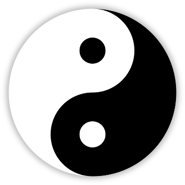

THE MIDDLE WAY

As a thought experiment, much like Kant’s dove in the *Critique of Pure Reason*, imagine we must increase how far a bird can fly. A bird can only fly as far as its wings can take it. Its wings are dependent on the type of bird it is and its attributes: the wing size, how full its belly is, or its internal cognitive drive. Obviously, the problem here is that we need to get rid of the air since air is holding the bird back from achieving its goals. Right?

No. This is an absurdist representation of the problem but such notions and solutions to today’s problems are happening in society today. Even in our own minds, absurd solutions breed. The Middle Way is a means by which one looks to either extremes, choices, or states of being, and chooses the middle between the two. Most choices live in the grey area between two states. Love and hate? It is the grey area between any choice or any state.

Dialectical Behavior Therapy (DBT) was created in part to help people with Borderline Personality Disorder (BPD). Those with BPD suffer because many are unable to find the grey area in their lives. Many people who have been diagnosed with this debilitating life-long mental illness are only able to see and do one extreme or another.

And so, with people who have this trouble and people who do not, the Middle Way may be for one to explore either side of this duality – to research the extremes, with thought experiments or engagement. And once either side is examined, this person then drifts towards the middle. How can you understand a Republican if you have not embraced the idealism for yourself? Or vice versa? The following quote sums up this concept nicely:

“If you know the enemy and know yourself, you need not fear the result of a hundred battles. If you know yourself but not the enemy, for every victory gained you will also suffer a defeat. If you know neither the enemy nor yourself, you will succumb in every battle.” – Sun Tzu, The Art of War

If you are incapable or unwilling to embrace the idealisms of any side – of anything – you cannot find the Middle Way. Exploration of any side of the duality creates a better person, a whole person, where there wasn’t one before.

Imagine yourself in a chess match against an opponent who is going to destroy the foundations of your ideals or beliefs or identity. You must argue for and against everything you hold dear. Philosophers do this by arguing for their position and against it in a single book. Once you have contemplated everything, even your existence, then maybe you can walk the Middle Way.

Once you have achieved this you will find the duality of nature – Yin and Yang, yes or no, true or false, good and bad, one and zero, and others. You will find that these are merely words to describe a concept and may in fact exist on a scale and up to interpretation to a point.

{width=60%}

The duality of the Yin-Yang symbol illustrates this point perfectly as one color fades into another. Humanity even exists within a spectrum of experiences as no two people are alike. Even the law exists on a spectrum because it is ruled by people. Even murder can be rationalized. People find a reason for it every day, and it is still wrong. The state, too, sanctions the killing of criminals, and it still transgresses.

For example, a man is caught on video walking up to another person and shoots them – unfortunately, this happens every day – then the shooter declares he did it because his lover cheated on him with the recently deceased. During the trial, we hear an astonishing testimony of how the cheater stole a million dollars, kicked the accused from the home, and threatened legal action against them because the deceased had wooed them into doing so.

It seems everyone here is in the wrong but in this instance, the composition of the jury decides a five-year prison term is adequate instead of the death penalty – the accused did in fact kill someone. Given another time or the act of fate, a different composition of jurors the accused might have been sent to death row. Human experience and actions exist on multiple spectrums.

This is not arguing for the subjective nature of everything for there are objective and quantifiable realities. The 6 Paths are fixed points the Middle Way never splits: no stealing, no manipulating for gain, no murder, no lying or slander. Even if you extrapolate our Universe as existing on a fractal to be destroyed as if it never existed, to begin with, objectively you exist at this moment. Most experiences and actions reside within the confines of the reasonably predictable. In the era of Big Data, we can see this play out in statistical distribution – the dreaded bell curve.

When many hear of the bell curve they only think of the short-sightedness of their point of view, that the bell curve is inherently racist, misogynistic, or phobic in some way. That was never its intent and changing language does not mean its original intent isn’t used every day in schools and places of business. For if all humans are unique, and all experiences and actions are subjective, that means everything has a bell curve. Every state a human can be, or experience, or do can be statistically represented.

The center of the bell curve is where we want our experiences and actions to reside. We must not all follow the flow of ideology or the whims of the pack leader. In fact, contrarianism might be what is needed to prevent the ebb and flow of society from marching off a proverbial cliff in any direction.

Altruism can disguise as evil and can be just as controlling. Behind many human disasters and genocides was noble intention where the end justifies the means. Utopian idealism tends to end in authoritarian control because humans possess the abilities to imagine being willfully corralled and wholesomely freed while having the abilities to enact both realities.

Many failed civilizations have done this and in a very predictable manner. There are numerous historical accounts for this. In such times a firm Middle Way is needed to prevent the flow of power in whichever direction it is pulled.

This is not just a political or sociological matter. The Middle Way is about everything you do or say and only through Mindfulness can we examine our thoughts, actions, and feelings. The following are popular topics and you can use these as guides for how you can apply the Middle Way.

HISTORY

Many times, this book included, will use historical precedence for how we may view events in the future. When seeking the Middle Way using history as our subject but we must consider that history is not a crystal ball but rather a guide for how things may be similar. For example, there will never be another Hitler/Stalin/Mao/Genghis Khan, but there may be someone like them. Because culture, technology, and politics change so does the future, but this doesn’t always have to be within the realm of humanity.

The solar system and geology of Earth are every changing landscapes externally and internally. We are never in the same place in the cosmos as we were a moment ago. The internal structures of Earth’s volcanic anatomy are different then it was a thousand years ago. The Sun’s dynamic eruption mechanisms are not the same now as they were a hundred years ago. But these things are on cycles, but that doesn’t mean they will be precisely predictable: see the Milankovitch Cycles as a visual guide for variability and approximation.

Approach all things using the Middle Way including statistics and future telling.

CONSPIRACY AND SKEPTICISM

In the pre-internet world, information was only gained through friends/family, books, radio, and TV. This information was very much filtered by those sources. Today, in a post-internet world, we can consume as much information as we want, and sometimes, don’t want. In that changed world we have found that every combination of human exists in the things they have done, will do, their wants, desires, status, and more.

In the past, the world was abundant with assassinations, thievery, human trafficking, and more. The world hasn’t changed, just your immediate comfy surroundings and what information you consume. The age of information has made the actions of the human dredges of society to surface in plain sight on social media and the news. From that we find two sides: the conspiracy people and the skeptics.

From either side we do not get the full picture of reality. From the skeptical angle we miss the level of human corruption, desire, and need. From the conspiratorial angle we miss the level of chaos in the world. Sometimes it is a shady group of people, sometimes it is the planet Venus. Often times you can use the Middle Way as a guide when accessing a situation which will land you on either side of the equation.

UTOPIANISM AND DYSTOPIANISM

There is a segment of the Western world that believes that utopianism is possible. For these people virtue and activism is the means to achieve their goals of utopianism. This end result is oftentimes not because of sound philosophical reasoning, let alone debate, but the spearhead of a political worldview. Time and time again in history we have seen that in order to achieve utopianism you must stop the “other” group, or groups, that are preventing your utopianism. This is why there is a large segment of the Western world also that believes that it is heading towards dystopianism.

How many witch trials, eugenics, medications, science experiments, and lobotomy’s must be performed on our society before we learn our lesson by altruistic people on a path to a utopian society? Utopianism and altruism are worlds to describe the perfection of a worldview. That Utopianism and altruism can very much look like dystopianism and evil from another worldview. Using our Middle Way as a guide we can find a better path between the two dichotomies.

PROGRESSIVISM AND REGRESSIVISM

Using different forms of bias people are blinded by the fact that society and civilization is not always linear. Iran in the 1960s was a bastion of freedom until a totalitarian Theocracy was instituted. To those people their progressive society suddenly became regressive. This is oftentimes the ebb and flow of civilizations but as a whole, the world has become steadily more progressive and technological since the beginning of recorded history.

Our lives are very much give-and-take. People with children often know this the best. Our societies and civilizations are the same. We pay taxes so we have things. We revolt when things become corrupt. When a series of generations become too progressive a newer generation regresses the lot. A tale as old as time.

When we look to society, politics, and our role in shaping the future, we should use the Middle Way as a guide. We should live our lives capable of balancing between these two co-existences and mentally capable of shifting back and forth when society pulls too strongly to either end.
