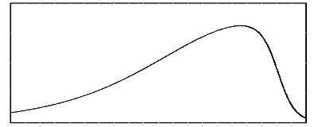

LIMITS OF COMPLEXITY

The philosophy and purpose around Novum Carta largely fall on the premise that as the entropy of a system increases so does its propensity for failure. Similarly, as the entropy in the universe increases it will eventually run down into disorder.

DEFINING SYSTEMS

A system is a group of individual components that perform a function. Systems can have subsystems that produce their own function that typically benefits the higher system or other systems around it. These functions usually require an input to produce an output.

These systems can be just about anything in existence, from atomic components, social hierarchy, ecosystems, economics, manufacturing, computer hardware, and more. Anything that consists of two or more independent objects that have a defined function is called a system.

A system that has no function is not a defined system. A silly example would be groups of people independent living on the Moon. In the case of our Moon men and women, they are fully autonomous, producing their own food and items needed to survive. If each of them is independent of one another, including Earth, they are not a system. However, if they banded together to produce raw material for use on Earth that would be a system.

All systems require an output, and that output can be a function. A simple example of this is a company that produces rope. Raw materials come in the front door and the product goes out the back. Similarly, the same is true, biologically, when you eat a chilidog for example.

Some systems may not readily have a defined output. If this is the case, we must examine either role on a macro scale: one or more systems up. This concept can be best illustrated with two examples. First, a black hole. A black hole consumes matter but generates various forms of cosmic radiation. It’s purely speculatory but on a greater level to our understanding, the black hole provides higher level functioning to the universe, a system.

Next is garbage collection in computer science. In software when a programming unit is no longer needed, it is sent to garbage collection where it is deleted from memory. Although the binary is gone the output of the garbage collection system is a function. That function is reallocating resources for the computer, a higher system.

Now that we have a basic understanding of what is required to make a system work, we must examine the exclusionary. The purpose of this section is an examination where the input, function, and output are in a state of imbalance in a system. Before we continue much further let’s discuss the terminology of systems.

TERMINOLOGY

ELEMENT

An element is a single unit of measure. This can be raw material, a person, a quark, an atom, a nation, or else. An element is dependent on the perspective of the observer. All elements are made of other nodes. From the perspective of the brain, it is an element and an Operational Element. From the perspective of a brain cell in the brain, it is an element with little knowledge of the greater whole. Perspective matters.

OPERATIONAL ELEMENT

An operational element is a set of elements, grouped, together that create an output or produce a function. Each element within usually accepts input, performs a function, or produces an output. An Operational Element is also dependent on the perspective of the observer and is more macro in scale than a node. Example Operational Elements are factory workers, a classroom, a family, a molecule.

FRAMEWORK

A framework is a set of elements or operational elements that if one fails the entire framework fails. Frameworks are typically immutable laws such as atomic structures, and cell biology. Economic or political theories are not frameworks.

THE COMPLEXITY PROBLEM

The more complex a system is, the more that can go wrong with it. The more that can go wrong the harder it is to maintain and fix. The more complex a system is the harder it is to keep it going and improving. There will be a time when systems can be so complex, they collapse from within.

Let’s take evolution and biology as an example in this experiment. Are we currently at an equilibrium of complexity of cell design? Evolution, the great biological experiment machine, has had a long run. In the past, it has probably encountered experimentations with different makeups of basic cell design and the subcomponents that exist within. Your skin doesn’t contain as many mitochondria as your heart for example, and for obvious reasons.

So, what happens if the skin did have as much mitochondria as your heart did? Could the host system survive the energy requirements needed for sustainability in the environmental system? Probably not for long without intervention because each mitochondrion needs fuel, oxygen, and upkeep, so extra capacity is a cost. Per thought experiment, we monitor our subject and make sure they have all the nutrients needed for survival. We are propping up a system doomed to failure which is out of equilibrium. Without intervention, our subject would cease to be and would die.

The most complex biological system is the brain. It is arguably the limit of biology at an equilibrium failing at a rate often as much as it succeeds. How does it fail you may ask? Through mental illness, dementia, seizures, and other genetic dispositions. You can make sure all nutrients are available for optimal brain performance but in reality, there are hard limits determined by the genetics you inherited.

I’m not discussing intelligence per se, but the mechanisms unique to your brain are required for its function.

My brain may synthesize dopamine better than yours. Yours may grow synapses faster than mine. I may have twice as many GABA receptors as you. These and many more metrics are some determining factors in who we are as separate people. The brain functioning optimally is deterministic of itself, your other bodily subsystems, and the environment you exist in. If either one is off, then the equilibrium of the brain fails. The result of this failure has many variables and outcomes.

Another example is manufacturing. Is it possible to create a device so complex it could never be completed? Is it possible to create a device where if one thing in the supply line fails the device couldn’t be made? Is it possible to build the infrastructure, the systems and subsystems, needed to construct the Death Star from Star Wars?

Manufacturing a product very simply is a system taking input to produce an output. Everything needed to convert the raw material into a product has its own subsystems. Getting the raw material requires systems to work effectively: the supply chain. Once the product is made other systems are needed to operate effectively to hand the product to the consumer. It was only a little over a hundred years ago a village blacksmith bought iron from a forge nearby and directly handed the horseshoes he made to the customer.

Now the supply chain from the product to manufacturing to consumer could involve hundreds of links in the chain. Hundreds of handoff points, involving hundreds of companies, involving dozens of countries, for a singular product later thrown in the trash in the West. A modern-day phone is the exact example of this.

During the 2020 pandemic, supply shortages, disruptions, failures, discontinuations, and alterations affected almost every company that sold any physical product worldwide and survived long enough to feel it. Every person in the world who was tied into the global system was affected.

The links in the chain were tested and a lot of businesses failed as a result. If you could not fix the broken link you failed. A lot of those links that were repaired were done solely through networking and the people you knew who could get what you needed. A system relying on systems.

I do not believe at this point in the time of this writing that any singular product has reached a hard limit of complexity however, the equilibrium is faulting. For this, we must define new terms for what we will use later.

TERMINOLOGY

FAILURE

Failure is defined as the element no longer performing its function or duty. This can last indefinitely or for a period of undefined time. Downtime is not considered a failure if there is another element capable of taking its place, readily and forever if need be. Failure of a node is evident from adjacent nodes but may not be from several operational elements away.

COLLAPSE

The term collapse is the failure of the operational unit for a period of time or indefinitely. Collapse is observationally dependent on the observer and can come from any direction. One node in the operational unit may not be aware of the collapse whereas it may be evident elsewhere. Adjacent nodes are aware of the collapse but those several operational nodes away may not notice. Nodes existing in different observational nodes may not notice until there are any noticeable cascading effects from the collapse.

CASCADING EFFECTS

Any nodes dependent on the function of another will incur effects from the failure. Operational units that collapse will incur cascading effects to other operational units and all nodes within them. These effects will vary on the node and its function. The output or function of the node may be limited or completely defunct.

THE GUARANTEE

Everything in society and our current Western civilization, a global civilization, exists within the framework of interconnecting systems. Much like all the cells working together in your body, so too are society’s systems working to generate the food you put in your body or throw in the trash when you are done.

If shipping ports aren’t working effectively there will be less fertilizer that makes the plants grow. If the rain is too much or too little the plants won’t yield. If the farmer dies suddenly the harvest doesn’t come. If the packaging plant can’t get enough boxes the food can’t ship. If the supermarket doesn’t have enough workers you can’t buy the food. At every step in the chain that’s less food for someone or something. Our backups often lean on the same few dependencies, like fertilizer, electricity, and the internet, even though each one makes sense on its own. Optimal conditions in absence of turmoil both political and environmental are needed for the proper distribution of goods.

The collapse of human-created complex systems is a guarantee. Unlike a biological cell that had billions of years to work out the kinks, human ingenuity potentially doesn’t have that long nor has it existed that long. We, humans, are effectively running our own evolution in real-time, making up new systems and modifying existing ones to find a balance. History is rife with such systems and new paradigms on how to tackle the same problems.

We assume beliefs of government, ideology, politics, identity into our cultures and run the experiment until failure, where we adapt or create new systems. There have been over eighty civilizations that have come and gone in the last five thousand years. Most of these have not been destroyed by invading armies. No, the majority of these civilizations have died from within; they created systems that couldn’t be maintained. The average lifespan of civilization is between 250 – 350 years. Luke Kemp counts 87 civilizations with an average lifespan of about 336 years (BBC Future, 2019). An earlier study, J.D. Unwin’s *Sex and Culture* (1934), looked at 86 societies, most of them tribal and six of them civilizations, and at how cultures decline.

As societal systems become more and more complex failures occur that cannot be remedied and thus collapse occurs and incurs cascading effects pulling down more and more dependent systems. Collapse isn’t an event, it’s a process. Don’t be mistaken though, collapse can occur quickly in a race for equilibrium at the “bottom.” The slow rise and the quick fall is called the Seneca Effect/Collapse, a name Ugo Bardi gave it in *The Seneca Effect* (2017) after Seneca’s line: “increases are of sluggish growth, but the way to ruin is rapid.”

{width=60%}

For civilization, growth comes slowly, but the fall comes fast. You can see this in the stock market or crypto-currency crashes. Depending on the nature of the cause of the societal collapse, the bottoms of these lows are dependent on the previous highs.

When Roman society diminished, and people fled the cities they not only abandoned the barbarian hordes but also the interdependent systems used to prop up their society. When the Goths cut Rome’s aqueducts during the siege of 537, the people who could have maintained them were gone, so the aqueducts fell into disrepair and water stopped coming into the city. In the late Western Empire, roads stopped being maintained. Tainter reads Rome’s fall the same way: a society that could no longer afford its own complexity. The “bottom” of the fall was whatever technology, belief, and infrastructure that could be readily maintained by the common man, that permeated in everyday homes, villages, and the countryside.

Barring a coronal mass ejection (CME) or an asteroid strike on Earth, the fall of our own civilization could be similar. There are two paths to consider regarding our own demise. One is that due to over-specialization in technology and all the specialization required for its creations, that the bottom of our collapse will be further than anticipated. The other path is that because of the depths of technological permeation and the abundance of knowledge that the collapse will be less than anticipated.

There is probably an equilibrium between the two paths due to the two following reasons. First, the initial sparks of decline matter a lot. Those initial sparks cause failures and cascading failures which are unique to the initial causes, the failures themselves, and how the culture at large reacts to those failures. Second, the speed of decline matters a lot as the speed allows those to prepare, safeguard, migrate, and/or mitigate. The speed is dependent on the failures, social cohesion, and autonomy of the culture.

One thing is clear though. Once enough failures cause collapse, regardless of the reason, it is rarely stopped. Nearly every collapse that historians and anthropologists are aware of can be traced to systems that grew too complex to maintain, as Joseph Tainter argues in *The Collapse of Complex Societies* (1988). This means our own collapse will come as surely as our own deaths. It’s a guarantee. Collapse happens like a human dying. Some of us die slowly, others suddenly. We can never tell. Every cause has an effect. Everything has rhythm. Everything is dual and has a beginning and an end.
