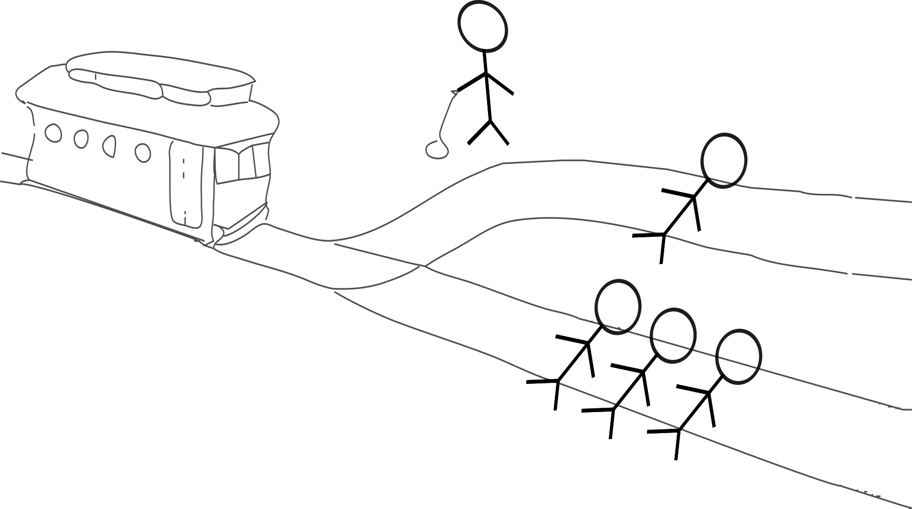

ACTION AND INACTION

Morally we are bound by what we do driven by Kant’s philosophies on duty. Hume and Kant had different approaches to blame or the root of moral action or responsibility. Hume for example weighed an event as morally good or bad by how it made you feel. Kant, for simplicity, stated that good and evil are one of intent. Novumist philosophy expands on these notions, goes further than most Western thought, and adopts the concept of “inaction.” John Stuart Mill came close in *On Liberty* (1859): a person “may cause evil to others not only by his actions but by his inaction.” Let’s examine these with a thought experiment.

A bricklayer is working on a building. One day he climbs the scaffolding and notices a precariously loose brick. He does nothing about it and goes about his day nonetheless. The next day, without any intervention, the loose brick slips its place and falls on someone below, killing them. Is the bricklayer to blame?

Our legal system is rife with placing blame and uses such concepts like homicide, murder in the 1, unintentional homicide, and the like. Kant, who believed that intent is everything, gave this idea its most famous philosophical form. If this case of the bricklayer’s accident went to court the bricklayer will almost certainly not be convicted of murder but manslaughter, an unintentional killing, may be a different story, even if he could prove it was an accident. Hume grounded morality in how an act makes us feel: because the person died and a person's death makes us feel bad, the action was morally wrong. A strict reading of Kant’s focus on intent would say because the person intended no harm there are no moral issues here.

Novumists however believe that a moral transgression occurred much like Hume, but instead blame the inaction of the bricklayer, his negligence. We believe humanity is imbued with knowing what may occur as a result of not doing something. We believe that when he noticed the brick that his mind would have postulated of it falling; he after all determined that it was loose, how could you not come to the next step in the equation?

This notion is far-reaching in that it places a huge amount of social responsibility on the individual. For example, when you see a homeless family living in a tent on the side of the road, if you do not intervene somehow your inaction is morally wrong. Even the slightest action of giving them an extra can of corn while returning home from a grocery trip corrects this inaction. Small incremental actions could help this family out of homelessness far sooner than you’d think. Can you imagine a world where most people made small changes and how quickly things would improve?

The argument against moral inaction is that it interrupts an individual’s free will, their self-determination, and one’s self-autonomy. Our answer is that a person’s self-image and honor should be centered on the collective as well as on themselves.

Japanese culture is a prime example of this concept. In Japan, there is shared social responsibility. This is carried out by actions such as wearing a mask outdoors when not feeling well, collectively picking up trash in your neighborhood, not playing music too loudly, and more.

There is an understanding that your actions and inactions directly impact those around you. Your honor is at stake the moment you decide on an action.

The West is at its worst a culture of narcissistic individualism whereas Japan is one of quiet collectivism. In the West, one looks at the loose brick and internally thinks “I didn’t do this, it’s not my problem.” Whereas in Japan one internally thinks “I didn’t do this, but this is my problem.” It is our responsibility to make small changes. To absorb the problems caused by others or nature and implement a solution.

Altruism isn’t absent in the West but fake altruism is, and comes in the form of the concept of “virtue signaling.” This is where you espouse a moralistic belief on a topic but have no follow-through. Take for example a politician who runs and wins an election on a platform to end homelessness. They get into office then six years later no progress has been made. They give no detailed statement as to why there is no progress except a blanket remark blaming others, their political rivals, or even the public. Incremental solutions could be performed but the problem is ineptitude, corruption, or lies. In the eyes of a Novumist, this politician is breaking a moral pledge through inaction.

Take for example a parent or sibling who chooses not to share their home with a family member facing homelessness. Their inaction of not intervening is a bad moral act, unless that person is a danger to them or their family; then they should intervene some other way. How about an adult sister who doesn’t intervene while her mother is engaged in a Munchausen syndrome by proxy with the other sister? The act of the sister choosing not to help, to stay out of the affairs of others, is an immoral act almost as bad as the psychological torture endured by the other sister at the behest of the mother. The choice not to do something is still a choice.

Take for example the famous Trolley Problem. There is one railroad track that converges into two tracks. On the single track is a train. On the two tracks are people tied up. One track has multiple people, the other one person. You stand in front of a switch that, when activated, moves the train from one track to the other. Regardless of what happens someone will die and you are in control of how many.

{width=60%}

Do you activate the switch and kill one person? Do you do nothing? Is the act of doing nothing still killing someone? Novumists believe that even the act of not doing something is still a choice.

However, the consequences for not doing something should not be the same as if you directly made the choice. We see this concept of inaction again in our legal system under negligence laws. Moral infractions shouldn’t incur legal punishment with exception of when bodily harm has occurred. Historically, social ostracism, the loss of reputation, has been enough of a consequence for moral infractions.

For a Novumist the moral implication of inaction is ½ as bad as the actual act. Half is the guide, not a ceiling; some cases, like the sister’s, weigh heavier. If your inaction caused someone to die your negative moral weight is ½ of homicide; an approximation of negligent homicide. If your inaction causes someone to kill themselves your moral misconduct is ½ that of suicide. Suicide has many causes, and no one sees every sign. If your inaction is not feeding a homeless person your moral misconduct is ½ that of taking their food away. If a family member becomes mentally ill and you could have intervened and chose not to, through your inaction your moral baggage is ½ that of anything that person does; if they become homeless ½ of that is your fault.

Morality through action and now inaction is how we find accountability as a society that is ever dependent on one another. The moral weight of an action or inaction is a subjective measurement and guide to the severity or consequences thereof: karma. This is how one should conduct themselves.

But a caveat must be made to this because the “hijacking” of inaction for nefarious purposes can be made to the detriment of a larger society. And again, I emphasize the point, that oftentimes bad things happen because of good intentions. Those bad things usually move out of balance and into the order-chaos spectrums. Some examples:

Example: People cause pollution. Pollution leads to climate change. Climate change leads to death. Not doing something is immoral. It is better to not have people who will lead to more climate change than for those people to later die.

Example: Crime is rampant. People X are causing most of the crime. To not do something is immoral. We must get rid of People X.

Example: Country Y is harboring terrorists. To not do something is detrimental to the region. We must invade that country to make us safer.

In general, the philosophy of inaction probably should not extend to the greater society and especially should not dictate political or cultural decisions. The philosophy of inaction should be a personal decision or a small group decision and never extend beyond those realms. Each person, officials included, still answers for their own inaction, but this does not drive policy.
