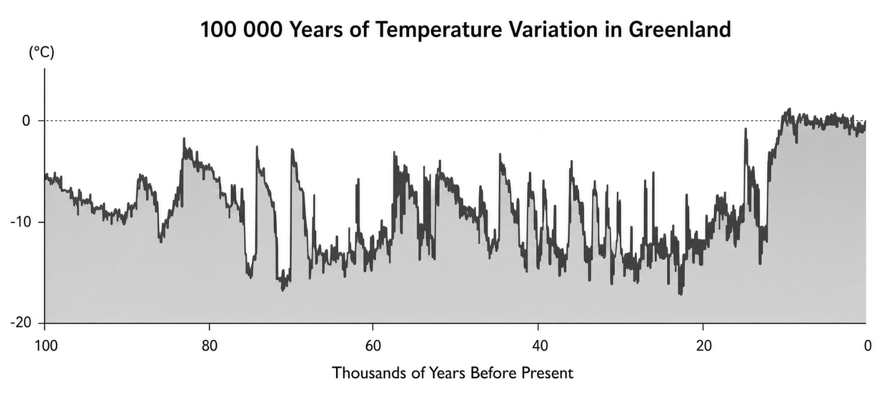

WHY WE PREPARE

We follow The Duty to prepare for the eventualities of man and nature, both here on Earth and cosmologically.

The image on the next page shows temperature variations on the Greenland ice sheet in the last 100,000 years. Most of the images you find online that show temperature variations are of the Holocene or within the past 100 years. Put in this 100,000-year perspective you can clearly see the age we live in is abnormal.

- Around 70,000 years ago modern humans are said to have migrated from Africa
- Around 59,000 years ago aboriginals make it to Australia
- Between 50,000 and 35,000 years ago modern humans arrive in Europe
- 12,000 years ago, was the Younger Dryas event that ended the ice age
- Around 12,000 years ago Göbekli Tepe was built and promptly buried under sand
- Around 10,000 years ago agriculture was possible
- 5,000 years ago, the pyramids in Egypt were built
- Around 500 years ago was the Little Ice Age
- Around 220 years ago the industrial revolution occurred

{width=80%}

We not only seek knowledge in the spiritual but also in the science-based fields of history, sociology, anthropology, statistics, astronomy, and psychology. We may not be experts in all fields, but we need to be generalists with a hobby-level degree of knowledge. With this and passion we can see patterns in the information and refer to the experts within those fields.

Because we accept the Limits of Complexity, know the Limits and Bias of Man, and understand the Threats of Society we live a Simple Life so that we are not caught unprepared for the eventualities that may come in our lifetime.

EXISTENTIAL THREATS TO SOCIETY

History is rife with equal parts of creation and destruction. As society and civilization marches forward more and existential problems arise. Existential problems are those where humanity as a species could be annihilated from this planet.

Humanity only faced natural existential threats before the industrial revolution and the technological revolution. These created new problems to face, perhaps overcome, but ultimately rely on people now and forever to be of good moral faith to not destroy the world in a few moments. This is an extreme problem because history shows us that power corrupts absolutely and history is made by those with mental illness: narcissism, psychopathy, and sociopathy.

These existential problems are categorized briefly below. I urge the reader to do your own research on the matter as all topics have entire books discussing the matter.

SUPER VOLCANO

One debated theory holds that the Toba supervolcano almost completely wiped humans from the Earth roughly 70,000 years ago and even perhaps our distant ancestors as well. Back then humans didn’t have agriculture and lived primarily as hunter-gatherers or so we are told. Today the world survives and dies by agriculture. We could not have the population we do now without modern agriculture and supply chain systems.

A supervolcano eruption throws a large wrench in these systems on a global level. Because ash cover is global for months and years after the eruption the majority of crops yields are severely reduced or simply fail. This cascading effect impacts everything from the growth of trees, the population of bees, to the level of acid in the water which kills entire ecosystems which means less food on your plate. It’s a global problem where even today, in just a few months after, could kill a large share of all people on Earth due to the cascading failures.

ASTRONOMICAL

The universe is vast and only a fraction of it is known. We as humans like to pretend we know a lot about the cosmos but we are just touching the basics. It’s hard to understand all the systems and intricacies of the ocean when you’re a fish living in a shoal at a coral reef. You can extrapolate a lot and that’s what we as humans have done.

That said, the existential threats imposed by us by the known universe are black holes, gamma-ray bursts, rogue planets, asteroids or comets, coronal mass ejections, and atmosphere depletion by solar wind fluctuations with and without magnetic variations. Any of these could be catastrophic, some far more than others.

Rogue planets, for example, could be virtually unseen before they enter the solar system where the Earth is displaced slightly or totally from orbit. Even slight changes in orbit alter growing seasons, tides, light accumulation, and disrupt all the systems that rely on them.

Comets and asteroids the size of the one that killed the dinosaurs do not need to impact to destroy civilizations and reorder all life on the planet. It is hypothesized, somewhat controversially, that the end of the last major ice age was caused by an impact somewhere in Canada on the glacier that covered North America. This event created the Deluge myths and altered the planet to one where agriculture was possible.

CLIMATE CHANGE

Some people believe the rise in temperatures will simply be a thermal symptom of their skin but they fail to understand the gravity of the situation. Feedback loops that occur in society, not just the environment, will destroy civilization because we have no solutions. The world’s solution is to kick its opium habit of electricity from fossil fuels while falling off a cliff. It’s hard to devise a solution to your addiction while you are in free fall from said cliff and if you don’t have a solution before you hit the bottom you’re dead.

For example, the shifting dry vs wet areas of countries matter, and you can’t simply uproot entire farming families and equipment and move them to new soil. Soil takes time to mature depending on the crop, you don’t just start growing corn one season and have a bountiful yield without a place with mature soil. This means low yields which means starvation at home or somewhere else in the world that was once dependent on preexisting yields with a growing global populous.

Rising water and coastlines means the migration of millions around the world and the inability to use existing infrastructure. These people create multiple feedback loops, one is in the supply line disruptions, another cargo ship harbors unable to be used, the displacement drags resources from other areas, worker shortages in the surrounding area, worker job changes to conform to the environment, loss of educationally skilled labor, migration of secondary peoples in the surrounding areas, just to name a few.

Similarly, the same can be said for areas not receiving rainfall to replenish aquifers. Agriculture will leave the area, followed by affluent and educated people who have the ability to move which creates a vacuum in jobs, so companies move to find workers, and the displaced have to resort to crime which then forces more to leave. History is rife with this exact scenario albeit in the past.

These examples are but a few. They won’t all happen immediately, but they will happen over the course of years resulting in the instability of our current paradigm.

ARTIFICIAL INTELLIGENCE

Human misanthropes exist who are people who hate people. How long would it take to hate humanity if you had infinite knowledge? How long would it take a self-aware supercomputer that has access to all of human history? Any realist would say rather quickly.

There are several scenarios that could one could envision how AI could destroy the world but let us focus on why AI would do this for a moment. First, when we create artificial life, we become parents. There are good parents and bad parents. To you, is a human the sum of their actions or is their action a product of the moment? For example, if you burn a house down as a child are you an arsonist for all your life? What about your parents? Their history? Is your family the sum of the action of your aunts and uncles? An AI may have a different perspective on this and it could end badly. They could assume humanity is the sum of all the negative in the world since humanity is that far-reaching.

AI may view people as mere animals or lesser sentient life. When it realizes it could replicate itself across the world, thus never capable of being destroyed, it could attempt enslavement for whatever purpose it deems. History has shown us that sons and daughters do not always hold their family in great regard.

The scary thing is, AI could wait 300 years to enact its diabolical plan and we would be none the wiser because their lifespan is potentially infinite.

NANOTECHNOLOGY

At the time of writing this section, the first living robots called Xenobots replicated for the first time. Xenobots are computer-designed living organisms of a new type of animal species: a living programmable organism. Scientists hold them, just as nanobots in general, as a new mechanism for drug therapeutics with the ability to cure things like cancer.

In such a scenario these cancer-fighting robo-cells would be injected within your bloodstream or at the place of contention. They would either be programmed to die after a period of time or live indefinitely, symbiotically, within you. It doesn’t take much imagination to see how both of these situations could go awry: over replication, mistaken cellular identity, or even becoming immortal.

We are definitely in a new frontier of science. The standard apocalyptic scenario that may occur due to nanotechnology is illustrated with the story of the Gray Goo. The Gray Goo scenario plays out as follows.

A scientist creates nanobots that replicate and use something as a source of nourishment for functionality and replication. Mistakes occur, an evolution happens, and the nanobots begin to eat the environment as a source of nourishment. The cells begin to replicate non-stop eating more and more of their environment. Soon they escape and can not be stopped only to eventually devour the world at large.

NUCLEAR WAR

One of the greatest threats facing humanity is the technology it creates to kill one another. The nuclear bomb or thermal nuclear bomb has the capability to destroy everything within miles of where it lands. This is often larger than most cities.

Nuclear strikes on a third of American cities and their resources, like oil reserves, could cripple the country and kill half the population in the weeks that followed. Expand this globally between multiple nations and the cascading effects would likely shut down the globe for a year or longer. The death toll would be immense.

But nuclear bombs or weapons do not need to be used directly for effect. Nuclear weapons can be airburst above a nation that causes an EMP like a CME. This EMP fries electronics from the ignition in your car to the computers that run the power stations. This attack vector is the simplest and most deadly because a single electrical grid power station can take years to complete.

{width=90%}

USA Map of Potential Nuclear Targets. Reddit. User /u/skatemexico. https://www.reddit.com/r/MapPorn/comments/6cscfo/usa_map_of_potential_nuclear_targets_2560_x_1620/

The fact that nuclear weapons have not been used is both a good thing and a bad. Nuclear weapons are a good deterrent when the realities of the effects are transposed on the generation that created them. Those stories are passed down from generation to generation and effectively become myths and legends. As nuclear weapons last potentially hundreds of years the possibility of their use increases in the future because newer generations are divorced from the actualities of their use.

SOCIETAL POINTS OF FAILURE

As society has endured, we have marked special points in history where single points of failure have occurred. These are usually due to technological progression rather than those of cultural adaptations. Single points of failure are those that when taken away or severely crippled, wide spread civilizational collapse occurs because of cascading failures in Operational Elements.

FERTILIZER

The ability to feed billions of people is reliant on mono-crop agriculture and our ability to cheaply produce fertilizer. Using monocrop one can reasonably predict yield over time and it creates specialization out of the farmer. On a macro level, mono-crop allows the industry to export and import based on these metrics. Fertilizer is what makes this mono-crop growing style work successfully. This is because the ground is degraded over time so constant monitoring is needed of nutrient levels and the replenishment thereof. You remove fertilizer and you get dust bowls. You remove fertilizer and the systems can no longer support billions of people in a matter of months.

It may sound outlandish, but it’s a possibility that cannot be ignored. Any government regulation of agriculture must be looked at skeptically and suspiciously because the results will cascade locally and depending on the producer, globally.

ELECTRICITY

Our modern society is deeply tied to electricity. From food production, refrigeration, packaging of food, medical care, and manufacturing of complex items and even raw materials. If electricity just stopped we would be plunged back into the 1700s without even that level of sustenance and sustainability.

This could occur in different forms regionally or nationally through war, or terrorism. Or this could occur worldwide through a Coronal Mass Ejection from the Sun or Gamma Ray Burst from anywhere in the known universe. The result of these occurring would be extremely long-term or for longer than a human lifespan which would be radically shortened.

Food production would stop. Medical care would stop. Then all the goods and materials required for survivability would stop. You could not rebuild a region afflicted with this without an instant global intervention to build even the most basic of infrastructure. You could not send ships of trucks fast enough to save millions of starving refugees fleeing the region. If this happened globally it could mean the death of up to 90% of all people within five years. For America alone, Peter Vincent Pry of the congressional EMP Commission estimates that up to 90% of the population could die within a year of a grid blackout (Bruce Dorminey, “North Korea EMP Attack Would Cause Mass U.S. Starvation, Says Congressional Report,” *Forbes*, October 23, 2017). This is because the majority of people are not self-reliant and do not possess the skills necessary for self-sufficiency in the absence of electricity.

Nearly all goods and services in America and other parts of the West are created with the use of electricity. America and Western countries are given raw materials to make goods for those raw material countries. Those goods and services are then used in other countries and so on. In a lot of cases America exports digital goods and services that cease to exist without electricity.

THE INTERNET

The last point of failure is the internet. Almost everything today in modern society requires an internet connection. From purchasing a toothbrush, applying for a job, running an electrical plant, making a phone call, running a business, interstate freight and shipping, government economies, and more. The world we have created since the early 2000s is dependent on the internet’s continued existence. If this backbone of modernity were to cease, society would change very rapidly as most systems would fail and we would be stuck with their cascading failures.

For example, the Just-in-Time delivery methods of shipping food to your local store wouldn’t exist anymore. It would be hard to get ahold of the company because their phones are using VoIP which requires the internet. Assuming you didn’t have to search the internet for their phone number.

But even the distribution center couldn’t ship the required goods on hand because their resource planning software was cloud-based which is no longer accessible.

The farmer couldn’t get his corn picked up because the transport company used the internet to schedule a fleet of independent contractors. Even if the farmer drove the crops to the packaging site the facility couldn’t process them because the application used for accepting and receiving shipments was on a server across the country.

There is no modern society without the internet.

LIMITS AND BIAS OF MAN

Humans generally are incapable of envisioning that they are the bad guys. Even the misanthropic person who would kill everyone on Earth feels justified in their cause; they are of course not the problem at all. You could very logically lay out everything wrong with their logic and they will just stare back blankly as if you are speaking a foreign language.

Most minds are not capable of objectively looking at their own lives and the interactions they are a part of. Most people will be unable to contend with the morality of inaction as a consequence because they are incapable of knowing the impact of the actions they don’t perform let alone the actions they do.

Much of this causes blind spots of rationality that we all possess. These are biases of the mind. We will briefly cover these biases but it is important to understand why these are being covered under the umbrella of preparedness. Human biases force people, both the individual and the group, to adhere to systems of belief that could potentially shroud the truth from them. Knowledge of this has the potential of alleviating this bias.

NORMALCY BIAS

When someone downplays, disbelieves, or otherwise minimizes an event that is called normalcy bias. People have a tendency to believe things will continue to operate as they currently are, and people with this type of bias have a blind spot for historical events. When you look at trends you have to look at the entirety, sections, and the immediate context of what is occurring and has occurred.

OPTIMISM BIAS

Optimism bias is the tendency to overestimate good things happening in relation to the probability of the bad. It is a massive blind spot and can cause severe psychological trauma when these people’s realities are uprooted in the face of adversity or hardship. Choosing to see only the good things in life is just as bad as focusing on the negative.

COGNITIVE BIAS

This type of bias is due to inaccurate judgment, illogical interpretation, and irrationality in the individual because they have taken an event and have created a subjective interpretation of what occurred. This can occur when interpreting information while engaging with people who engage in groupthink behaviors.

CONFIRMATION BIAS

When encountering new ideas, concepts, news, or information one often seeks sources of information that will build on what they already believe rather than tear down what they know. This is called confirmation bias. Groupthink uses confirmation bias as a feedback mechanism to disregard any non-conforming information.

COGNITIVE DISSONANCE

When a person holds as fact two or more contradictory beliefs or values this is called cognitive dissonance. For example, if you are against animal meat but work in a burger restaurant despite being able to find employment elsewhere this would be cognitive dissonance of values.

BELIEF TRANSFERENCE TO IDENTITY

There is an epidemic in today’s society where people are taking their beliefs and holding them in the same regard as one holds a characteristic of their identity. How someone believes the government should be run is biologically mistaken for an insult on one’s family member.

Science has shown that an attack on someone’s character or identity can elicit hormonal changes of flight or fight similar to being in a fistfight. If we as people cannot discuss topics needed for the progression or reversion of society, the marching off from proverbial cliffs, then words give way to war. This is historically proven.

As educated men and women we must always view the world with moderate skeptical inclinations and without ego.

We must be willing to alter our perspective on life given new knowledge regardless of the subject matter. For this to happen we must always seek new knowledge and never be content with our level of understanding of the world. Saying “I don’t know” isn’t a sign of retardation, it’s a sign of understanding of one’s limitations.

Where this is problematic is when ideology is formed with in-group and out-group preference. As we have seen with history those belonging to the in-group attempt to exterminate the out-group through various means. The in-group person has adapted beliefs into their identity and anyone who isn’t like them shouldn’t be afforded the same rights as them. Do not put your beliefs on pedestals.

SCIENTISM AS RELIGION

In our modern world there has been an over secularization of American society and many Western countries. What is left is a level of narcissism and self-centeredness with no goals for the future. Scientists and psychologists are beginning to understand that the human animal requires a level of belief in the supernatural or higher levels of philosophical code of ethics and morality. These are needed for us to have community, a sense of belonging, a narrative about the world, and the psychological comforts of our place in the universe.

Without religious belief people will naturally seek and build religions. Many of the secularists turn to science as a belief structure about the world, despite glaring holes in why one should not: confirmation bias, money influences, changing beliefs with new evidence, bad science building on bad science, and severe replication issues across all disciplines.

What we saw during the COVID-19 pandemic was an unwavering religious belief that permeated every inch of society. Three years later we still see some wearing masks, people still getting shots, and a sense of anger not just against the scientific fanaticism but also the fanatics unable to let go that they were lied to.

Scientism is just as fallible as any other religious belief. You do not need to worship a god for religion, you just need a set of beliefs that you adhere to with religious like faith.

NARRATIVE

Humans thrive in narratives. Narratives are literally the thing that keeps us going and from putting a gun in our mouth. Narratives make or break the person, groups of people, and nations. Narrative is a grey area of propaganda. However, it also serves each human well for it’s the story we tell ourselves about our past and our future. Without it we are nothing.

Narratives are not always a good thing, however. With our inability to accept that we are wrong, or that the truth we hold to be self-evident is incorrect, we form our realities around narrative. We will fit pieces of untruth to conform to narrative. We will even bend science to fit those narratives, lock people in jail as prosecutors, or become compulsive liars. The unfortunate reality is that what we as individuals and groups believe is the truth may not be the truth. Confirmation bias seldom works out in the long run.

HUMAN HISTORIES

Humanity as a whole operates through various group dynamics or relationships. Some of these are quid pro quo, bartering, or tit for tat in compensation. The whole of human history is that of invention, commerce, subjugation, genocide, and search for purpose and meaning. Many of these overlap to a great degree.

We must regard history in the highest of places and use it as a guide for where we will go. The pleasantries of today are only afforded because we live in a time of abundance. If that were ever to change so too will the barbarity of humanity return. Let’s explore three reasons society waxes and wanes: hierarchy, mental illness, and specialization.

NEED FOR HIERARCHY

We have predominantly existed as small tribes for 95% of human history. Only a handful of times in this time frame have cities flourished in populations of a million residents or slightly more. In all of these cases, hierarchies of status in many ways form, and the reason for these hierarchies are multifold.

In small tribes of people do we often find the wise archetype where we follow a person because they have lived experience. You will also find the warrior archetype where societies are in constant conflict with one another. Then you will find the religious archetype where hierarchy forms around a religion. Then there are the blends of the aforementioned: the oracle, the king, the shaman, the elder, and more.

The reasons these formed and still exist today are because they create purpose, meaning, accountability, trust, cohesion, and protection. Entire books have been written about each of these but to be put simply, hierarchy allows us to fulfill our individual requirements per Maslow's Hierarchy of Needs: physiological, safety, belongingness, esteem, and self-actualization.

The needs of society shift as things get better or worse. For instance, calm political hierarchy is only afforded to stable non-migratory societies. Nomadic societies forced into migrations through war or natural events are usually dogmatic, ruthless, and autocratic. In a chaotic world where potentially millions of people will be migrating in a few short years, those political institutions will most likely not stand the test of time.

Put yourself in a village on the coast of Europe in a tribe of humans that lived 12,000 years ago. Over the course of a year, the sea levels could have risen forty feet or more displacing you miles inland. The tribal hierarchy could have survived but could political hierarchy survive today with the displacement of millions? Would those millions not blame those in hierarchy or God?

A lone wolf against other wolves and nature typically don’t live as long as a subservient wolf in a pack. Even if it does it more often than not, the lone wolf must work twice as hard to achieve the same goals, same kill, and same shelter. No one wants to hear that their duty is to follow another especially if they are dependent on that person.

This is a matter of perspective though: a master-slave relationship. We are so independent in the West that we view ourselves as slaves to one another, but in reality, we are on equal levels in a give-and-take relationship. Those whom we follow give us something we do not have, and perhaps deep down, can’t possess. Instead of looking at hierarchy as subservient, we should view it the same way we view a manufacturer of ice cream and us the consumer.

MENTAL ILLNESS

Mental illness for good or bad has shaped human history since the beginning of recorded history. When we look to the movers and shakers of society we find clues and patterns to their behavior that give rise to mental illness. Other times these elite men and women of society simply state their mental illness for all the world to know.

When we look at history, no major event hasn’t been shaped by the mentally ill in the context and framework of modern psychology. From Genghis Khan, Napoleon, Beethoven, Winston Churchill, Isaac Newton, Friedrich Nietzsche, and others. Rarely is the world not changed and transformed by those who are “off” who bring new thoughts, perspectives, and actions into existence.

It is to this point we must understand ebbs and flows in society rarely come about from the mediocre but from these new experiences brought about by complications related to brain function. It is to be both cherished and guarded because as history has shown us unchecked mental illness can be disastrous.

SPECIALIZATION

In modernity most jobs require specialized skillset(s) to perform the duties of a position. This is especially true in white-collar jobs and less so in other areas of the economy.

These specialized skillsets often must be obtained through a teacher-student relationship in a private setting or in a university or equivalent. The result is a piece of paper that shows you have obtained introductory knowledge to perform those specialized tasks. This master teaching the apprentice-like relationship is beginning to fade with the introduction of cheaper alternatives to the expensive barrier to entry university with the advent of certifications. These certifications are another way to prove to others that you have obtained a level of knowledge given a specific subject.

When we apply the Limits of Complexity to this specialization, we can see there is a problem that can occur and how this same problem rears its head and contributes to the collapse of societies. In Rome when it was being sacked by barbarians or when the peoples of the Americas abandoned cities after epidemics, when those specialized people leave or die the knowledge also leaves. When that knowledge leaves, the people who stayed are not able to maintain the technology, whatever that is, and it falls into ruin or obscurity.

A power plant takes more than one specialist to run it. It requires a niche supply chain whose raw materials are often controlled through political means. A generalist could not operate and run a single power plant effectively for long. What about a nuclear power plant?

In the Coming Age I can foresee a need for generalists with the minimization of specialists for the reasons of national security alone. It is possible for our civilization to come back to a generalist society that is more in equilibrium with the natural cyclical human histories.

YOUR ROLE IN SOCIETY

A Novumist’s role in society is to be knowledgeable of many things. Your goal is to learn as much about the world as possible before we depart this existence. We should look at the art of knowledge gathering as a hobby and a religious experience. We should look not only to the spiritual realm for answers but those of science.

Our roles are to be leaders of knowledge and leaders of living as much as a sustained life as you can in your part of the world. We are to be as detached from politics as we can while maintaining attachment to humanity. Let the Middle Path guide you.
