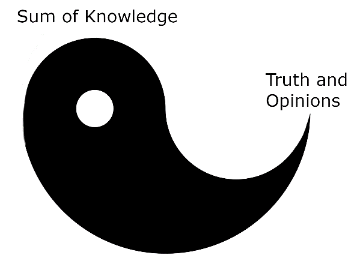

TRUTH AND KNOWLEDGE

Novumists seek knowledge for knowledge’s sake and for The Duty. We do not seek truth, we seek information. The two blend as the Yin and Yang, the large part is the information you have, the edge stretching out is your analysis of the information.

{width=50%}

Truth and opinion exist out of the sum of our knowledge. This knowledge can be content from books, podcasts, TV, conversations we’ve had, and lived experience. Truth and opinion are the interpretation of that data. This data can be compiled differently from person to person and the output can be of different conclusions.

Take for example two people standing next to one another. Both witness a crime occur. Person A says it was because of one reason. Person B says it occurred for a completely different reason. Who is correct? Could both realities exist? What is the truth? This scenario plays out all the time because the knowledge we have at the time of the event influences our perception of reality just as much as perception and memory formation.

The narrative and story we tell children for why they go to school is to fill them with knowledge. This is only partially correct and only half the equation. The teacher’s job is to form that knowledge into the perceived correct narrative of truth, to create a unified opinion about reality. Depending on the teacher or the content you consume while in a class, a completely different set of truth can arise from the same subject matter.

Have you ever thought of something that changed your life? Have you switched your opinion on something that influenced you for the better or worse? Has a new perspective on an event had a positive impact on you? New ways of thinking change the world in many ways such as inventing things or creating new systems for society. New thinking can also lead to paradigm shifts in society and lead to revolution.

Be wary of truth especially systems of mass truth that require conformance. For systems of control: the media, academia, Big Tech, the government, the narrative and unified opinions, and truth about the world is imperative to their survival and to a degree our own.

When you buy into the narrative you reap the rewards of society, when you don’t you are shunned and removed from the fruits of its labors. Any new government will attack the truth of the previous government. These new governments sow discontent of those who have knowledge because knowledge forms truth, and they try to override the mind in the other direction: pushing truth as knowledge. This is how society operates for good or for bad, the art is the balance, which gives freedom or tyranny.

Complete freedom of truth and narrative creates an uncontrollable society and a non-cohesive one. This society will be susceptible to control by strong narratives of control. Complete control over narrative and truth creates a controlled society and a cohesive one. This society will be susceptible to control by counterthought and counter-narratives. Here we can see the Hermetic Principles playing out in societal control: Everything has Rhythm, Everything is Dual, and Everything Has a Cause and Effect.

Truth is subjectively objective in that there is objective truth about reality but most of it is simply our best understanding at this moment in time. Some things are objective regardless of opinion or narrative, while some things are always subjective. The rule of thumb when telling objective versus subjective is that objective truth is naturalistic and quantifiable, subjectivity is interpretations based on that information.

Translating naturalistic observations form paradigms that reinforce themselves and permeate through society creating more feedback loops. With knowledge of this and knowledge of human histories one can map a lineage of these paradigms in philosophical thought and the progression of religion since recorded history. And because of this, truth changes the world.

It is our duty as Novumists to understand this reality about knowledge and truth. Knowledge is more important than truth. When someone tells a lie, you smile. When someone tells a half-truth, you nod. When someone tells a truth, you laugh because you know it could be wrong in ten years. Truth isn’t a destination or termination point, knowledge is.