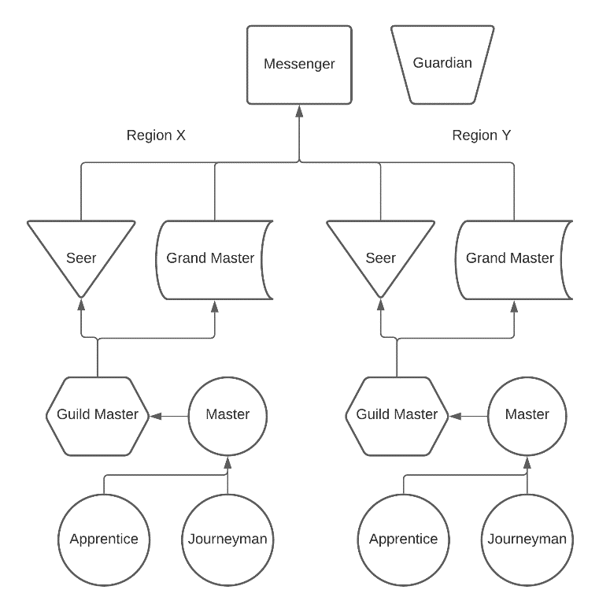

HIERARCHY AND STRUCTURE

In this section, we will discuss how members are ranked, what is required for them, and how communities of Novumists are organized. Joining is free. Communities and Guilds tithe to support their own work.

{width=80%}

Messenger (rectangle). Guardian (trapezoid) sits beside Messenger, with no line from below.

Region X
Seer (inverted triangle) and Grand Master (flag) sit side by side.
Guild Master (hexagon) ← Master (circle).
Apprentice (circle) and Journeyman (circle) point up to Master.
Guild Master and Master point up to Seer and Grand Master.

Region Y
Seer (inverted triangle) and Grand Master (flag) sit side by side.
Guild Master (hexagon) ← Master (circle).
Apprentice (circle) and Journeyman (circle) point up to Master.
Guild Master and Master point up to Seer and Grand Master.

Both regions join a line that points up to Messenger.
