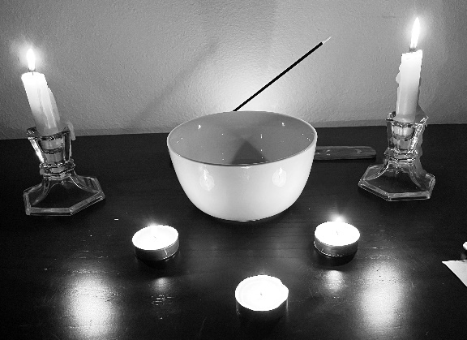

BASIC BURNING BOWL RITUAL

Warning: When doing this ritual be aware you will be invoking something primal. When you peer into the darkness something will peer back. Your prayer will need to be specific as to what you want. Leave nothing to chance. Be specific.

- Do not do this on or near carpet or anything combustible.
- Never leave the flame unattended.
- Keep water at hand.
- Keep children and pets away; minors only with an adult.
- Do not do this while the AC is on.
- Do not do this while a fan is blowing in the room
- Do not evoke chaos gods.

The basic prayer burning bowl ritual consists of a few elements:

- A ceramic bowl
- Candles - three to four
- Incense - sage is typically used for cleansing
- A lighter
- A small piece of paper (Around 4 inches long by 1 inch in height)
- Something to write with

{width=40%}

At night set up the candles the way you'd like and light them. Put your prayer bowl near where you will be sitting. Turn off the lights and sit and meditate for 5 minutes or so to transition your mind to the task at hand. When you are ready take the piece of paper and write what you want in your prayer.

The prayer can be anything you need or want, for yourself or your friends or family, now or in the future. Be very specific, however (read the warning above). Invoke a god or not. One will find you. Do not evoke chaos gods.

Write your prayer down. Fold it in half. Speak it out loud. Close your eyes, and visualize the prayer working. After a few moments open your eyes, and over the bowl light the piece of paper on fire and drop it in the bowl.

Once the paper has burned the paper fully to ash, close your eyes and meditate for 5 more minutes.
